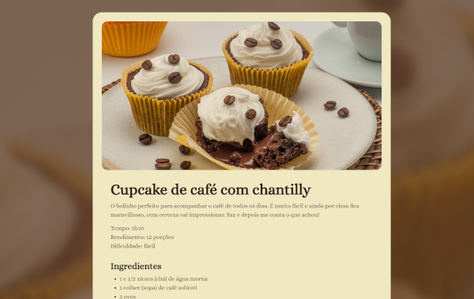
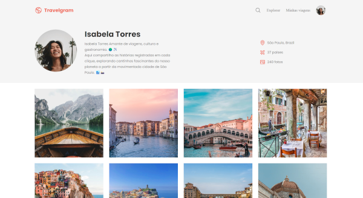
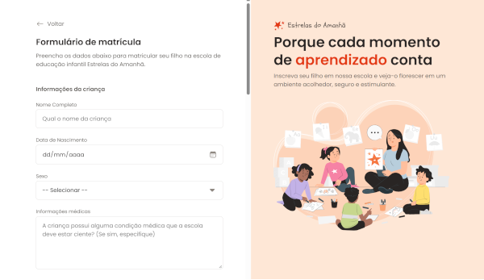
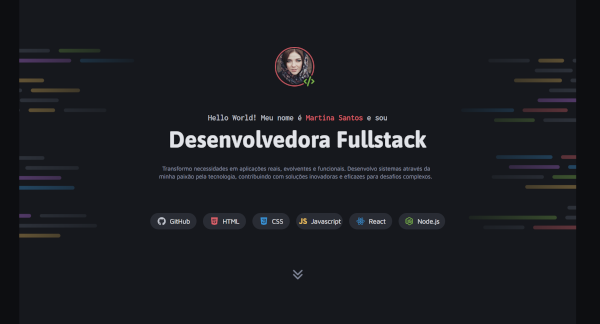
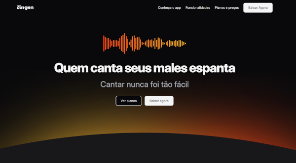
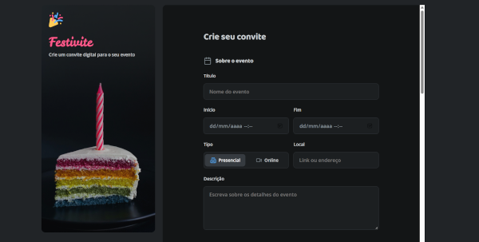
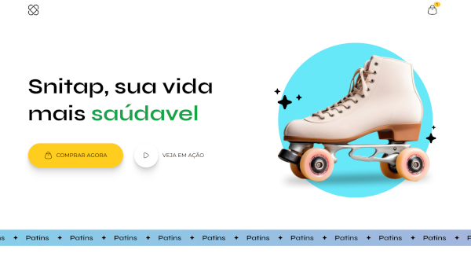

🌐 **English** | [Português](README.md)

# 🚀 Course Project: Rocketseat Projects

[](https://developer.mozilla.org/docs/Web/HTML) [](https://developer.mozilla.org/docs/Web/CSS) [](https://developer.mozilla.org/docs/Web/JavaScript)

This repository brings together the projects I built during the Rocketseat course, focused on HTML, CSS and JavaScript. Each project lives in its own folder and has its own README with the details.

## Table of Contents

- [Projects](#-projects)
- [How to clone a single project](#-how-to-clone-a-single-project)
- [Repository structure](#-repository-structure)
- [Author and Credits](#-author-and-credits)

## 📚 Projects

<table align="center">
  <tr>
    <td align="center" width="33%">
      <br>
      <b>Recipe Page</b><br>
      A page with the ingredients and preparation steps of a recipe.<br>
      <a href="https://erikaestudar.github.io/course-project/pagina-de-receita/index.html">Live demo</a> | <a href="https://github.com/Erikaestudar/course-project/tree/main/pagina-de-receita">Code</a>
    </td>
    <td align="center" width="33%">
      <br>
      <b>Tourist Spot</b><br>
      A presentation page for a travel destination: Busan.<br>
      <a href="https://erikaestudar.github.io/course-project/local-turistico/index.html">Live demo</a> | <a href="https://github.com/Erikaestudar/course-project/tree/main/local-turistico">Code</a>
    </td>
    <td align="center" width="33%">
      <br>
      <b>Travelgram</b><br>
      A travel page with search and a mobile menu.<br>
      <a href="https://erikaestudar.github.io/course-project/travelgram/index.html">Live demo</a> | <a href="https://github.com/Erikaestudar/course-project/tree/main/travelgram">Code</a>
    </td>
  </tr>
  <tr>
    <td align="center">
      <br>
      <b>News Portal</b><br>
      A news portal with a featured-stories layout.<br>
      <a href="https://erikaestudar.github.io/course-project/portal-de-noticias/index.html">Live demo</a> | <a href="https://github.com/Erikaestudar/course-project/tree/main/portal-de-noticias">Code</a>
    </td>
    <td align="center">
      <br>
      <b>Enrollment Form</b><br>
      An enrollment form with registration fields.<br>
      <a href="https://erikaestudar.github.io/course-project/formulario-de-matricula/index.html">Live demo</a> | <a href="https://github.com/Erikaestudar/course-project/tree/main/formulario-de-matricula">Code</a>
    </td>
    <td align="center">
      <br>
      <b>Portfolio Dev</b><br>
      A personal portfolio to showcase projects and contact details.<br>
      <a href="https://erikaestudar.github.io/course-project/portfolio-dev/index.html">Live demo</a> | <a href="https://github.com/Erikaestudar/course-project/tree/main/portfolio-dev">Code</a>
    </td>
  </tr>
  <tr>
    <td align="center">
      <br>
      <b>Zingen</b><br>
      A presentation page for Zingen.<br>
      <a href="https://erikaestudar.github.io/course-project/zingen/index.html">Live demo</a> | <a href="https://github.com/Erikaestudar/course-project/tree/main/zingen">Code</a>
    </td>
    <td align="center">
      <br>
      <b>Invitation Form</b><br>
      Festivite: a form to build a digital invitation, with name and email validation.<br>
      <a href="https://erikaestudar.github.io/course-project/formulario-de-convite/index.html">Live demo</a> | <a href="https://github.com/Erikaestudar/course-project/tree/main/formulario-de-convite">Code</a>
    </td>
    <td align="center">
      <br>
      <b>Snitap Skates</b><br>
      A page for a roller skate store.<br>
      <a href="https://erikaestudar.github.io/course-project/snitap/index.html">Live demo</a> | <a href="https://github.com/Erikaestudar/course-project/tree/main/snitap">Code</a>
    </td>
  </tr>
  <tr>
    <td align="center">
      <br>
      <b>Encantos Literários</b><br>
      A page for a book subscription club.<br>
      <a href="https://erikaestudar.github.io/course-project/clube-de-assinatura/index.html">Live demo</a> | <a href="https://github.com/Erikaestudar/course-project/tree/main/clube-de-assinatura">Code</a>
    </td>
  </tr>
</table>

## 📥 How to clone a single project

You don't need to download the whole repository. With `sparse-checkout`, Git fetches only the folder you choose. In this example, the project is `portfolio-dev`:

```bash
# 1. Clone the repository without downloading the files yet
git clone --no-checkout --depth 1 https://github.com/Erikaestudar/course-project.git

# 2. Enter the repository folder
cd course-project

# 3. Enable the mode that downloads only chosen folders
git sparse-checkout init --cone

# 4. Choose the project folder
git sparse-checkout set portfolio-dev

# 5. Download the files of the chosen folder
git checkout main
```

For another project, replace `portfolio-dev` with its folder name. To download more than one, list the names separated by spaces: `git sparse-checkout set portfolio-dev snitap`.

## 📂 Repository structure

```text
course-project/
├─ clube-de-assinatura/
├─ formulario-de-convite/
├─ formulario-de-matricula/
├─ local-turistico/
├─ pagina-de-receita/
├─ portal-de-noticias/
├─ portfolio-dev/
├─ snitap/
├─ travelgram/
├─ zingen/
└─ README-en.md
```

## 👩‍💻 Author and Credits

Projects developed by [Erika Sugawara](https://github.com/Erikaestudar) as part of her studies at [Rocketseat](https://app.rocketseat.com.br/jornada/full-stack/conteudos).

- **GitHub:** [@Erikaestudar](https://github.com/Erikaestudar)
- **LinkedIn:** [Erika Sugawara](https://www.linkedin.com/in/erika-sugawara/)

**Built with ❤️ as an educational project**
