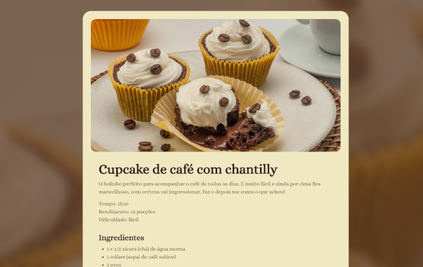
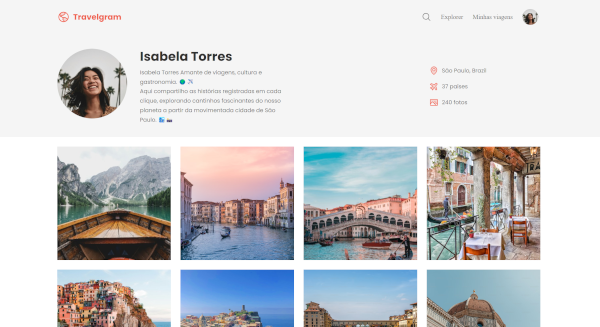
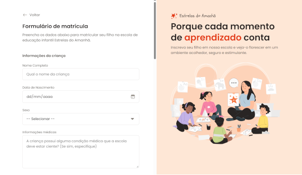
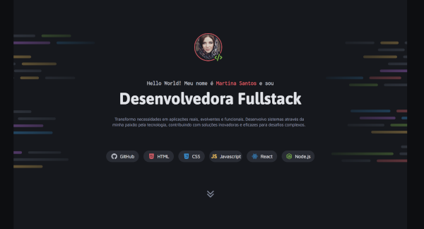
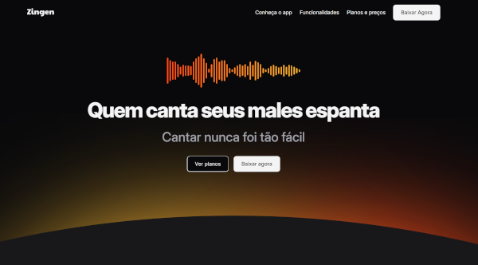
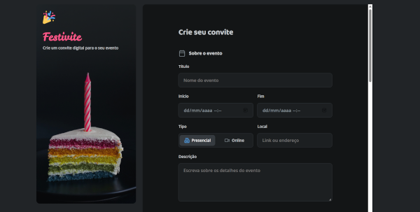
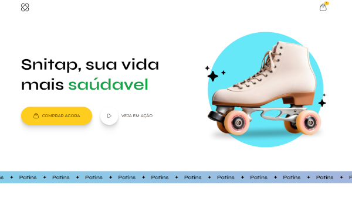

🌐 **Português** | [English](README-en.md)

# 🚀 Course Project: Projetos da Rocketseat

[](https://developer.mozilla.org/docs/Web/HTML) [](https://developer.mozilla.org/docs/Web/CSS) [](https://developer.mozilla.org/docs/Web/JavaScript)

Este repositório reúne os projetos que desenvolvi durante o curso da Rocketseat, com foco em HTML, CSS e JavaScript. Cada projeto fica em uma pasta própria e tem seu próprio README com os detalhes.

## Sumário

- [Projetos](#-projetos)
- [Como clonar apenas um projeto](#-como-clonar-apenas-um-projeto)
- [Estrutura do repositório](#-estrutura-do-repositório)
- [Autoria e Créditos](#-autoria-e-créditos)

## 📚 Projetos

<table align="center">
  <tr>
    <td align="center" width="33%">
      <br>
      <b>Página de Receita</b><br>
      Página com ingredientes e modo de preparo de uma receita.<br>
      <a href="https://erikaestudar.github.io/course-project/pagina-de-receita/index.html">Ver online</a> | <a href="https://github.com/Erikaestudar/course-project/tree/main/pagina-de-receita">Código</a>
    </td>
    <td align="center" width="33%">
      <br>
      <b>Local Turístico</b><br>
      Página de apresentação de um destino turístico: Busan.<br>
      <a href="https://erikaestudar.github.io/course-project/local-turistico/index.html">Ver online</a> | <a href="https://github.com/Erikaestudar/course-project/tree/main/local-turistico">Código</a>
    </td>
    <td align="center" width="33%">
      <br>
      <b>Travelgram</b><br>
      Página de viagens com busca e menu para celular.<br>
      <a href="https://erikaestudar.github.io/course-project/travelgram/index.html">Ver online</a> | <a href="https://github.com/Erikaestudar/course-project/tree/main/travelgram">Código</a>
    </td>
  </tr>
  <tr>
    <td align="center">
      <br>
      <b>Portal de Notícias</b><br>
      Portal com layout de notícias em destaque.<br>
      <a href="https://erikaestudar.github.io/course-project/portal-de-noticias/index.html">Ver online</a> | <a href="https://github.com/Erikaestudar/course-project/tree/main/portal-de-noticias">Código</a>
    </td>
    <td align="center">
      <br>
      <b>Formulário de Matrícula</b><br>
      Formulário de matrícula com campos de cadastro.<br>
      <a href="https://erikaestudar.github.io/course-project/formulario-de-matricula/index.html">Ver online</a> | <a href="https://github.com/Erikaestudar/course-project/tree/main/formulario-de-matricula">Código</a>
    </td>
    <td align="center">
      <br>
      <b>Portfolio Dev</b><br>
      Portfólio pessoal para apresentar projetos e contatos.<br>
      <a href="https://erikaestudar.github.io/course-project/portfolio-dev/index.html">Ver online</a> | <a href="https://github.com/Erikaestudar/course-project/tree/main/portfolio-dev">Código</a>
    </td>
  </tr>
  <tr>
    <td align="center">
      <br>
      <b>Zingen</b><br>
      Página de apresentação do Zingen.<br>
      <a href="https://erikaestudar.github.io/course-project/zingen/index.html">Ver online</a> | <a href="https://github.com/Erikaestudar/course-project/tree/main/zingen">Código</a>
    </td>
    <td align="center">
      <br>
      <b>Formulário de Convite</b><br>
      Festivite: formulário para montar um convite digital, com validação de nome e e-mail.<br>
      <a href="https://erikaestudar.github.io/course-project/formulario-de-convite/index.html">Ver online</a> | <a href="https://github.com/Erikaestudar/course-project/tree/main/formulario-de-convite">Código</a>
    </td>
    <td align="center">
      <br>
      <b>Snitap Patins</b><br>
      Página de uma loja de patins.<br>
      <a href="https://erikaestudar.github.io/course-project/snitap/index.html">Ver online</a> | <a href="https://github.com/Erikaestudar/course-project/tree/main/snitap">Código</a>
    </td>
  </tr>
  <tr>
    <td align="center">
      <br>
      <b>Encantos Literários</b><br>
      Página de um clube de assinatura de livros.<br>
      <a href="https://erikaestudar.github.io/course-project/clube-de-assinatura/index.html">Ver online</a> | <a href="https://github.com/Erikaestudar/course-project/tree/main/clube-de-assinatura">Código</a>
    </td>
  </tr>
</table>

## 📥 Como clonar apenas um projeto

Não precisa baixar o repositório inteiro. Com o `sparse-checkout`, o Git traz só a pasta que você escolher. Neste exemplo, o projeto é o `portfolio-dev`:

```bash
# 1. Clona o repositório sem baixar os arquivos ainda
git clone --no-checkout --depth 1 https://github.com/Erikaestudar/course-project.git

# 2. Entra na pasta do repositório
cd course-project

# 3. Ativa o modo de baixar só pastas escolhidas
git sparse-checkout init --cone

# 4. Escolhe a pasta do projeto
git sparse-checkout set portfolio-dev

# 5. Baixa os arquivos da pasta escolhida
git checkout main
```

Para outro projeto, troque `portfolio-dev` pelo nome da pasta. Para baixar mais de um, liste os nomes separados por espaço: `git sparse-checkout set portfolio-dev snitap`.

## 📂 Estrutura do repositório

```text
course-project/
├─ clube-de-assinatura/
├─ formulario-de-convite/
├─ formulario-de-matricula/
├─ local-turistico/
├─ pagina-de-receita/
├─ portal-de-noticias/
├─ portfolio-dev/
├─ snitap/
├─ travelgram/
├─ zingen/
└─ README.md
```

## 👩‍💻 Autoria e Créditos

Projetos desenvolvidos por [Erika Sugawara](https://github.com/Erikaestudar) como parte dos estudos da [Rocketseat](https://app.rocketseat.com.br/jornada/full-stack/conteudos).

- **GitHub:** [@Erikaestudar](https://github.com/Erikaestudar)
- **LinkedIn:** [Erika Sugawara](https://www.linkedin.com/in/erika-sugawara/)

**Desenvolvido com ❤️ como projeto educacional**
