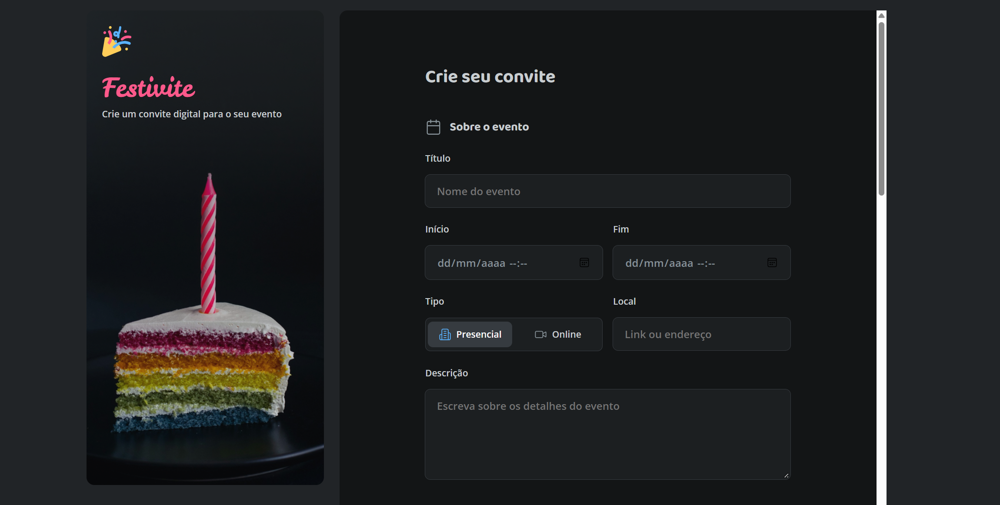

🌐 **English** | [**Português**](README.md)

# 🎉 Festivite Invitation Form

[](https://developer.mozilla.org/docs/Web/HTML) [](https://developer.mozilla.org/docs/Web/CSS) [](https://developer.mozilla.org/docs/Web/JavaScript) [](https://fonts.google.com/)

## 📖 About the Project

Festivite is a form page for collecting event details and visual preferences for a digital invitation. The interface is intended for people who want to enter information such as the event title, date, format, and description.

The form also offers choices for color, theme, style, and cover photo, along with contact fields and consent options.

The project presents the interface and validates the required name and email fields. Invitation generation and data submission have not been implemented.

## Contents

- [About the Project](#-about-the-project)
- [Screenshot](#screenshot)
- [Features](#-features)
- [Technologies Used](#-technologies-used)
- [Design Highlights](#-design-highlights)
- [Project Structure](#-project-structure)
- [View the Project](#-view-the-project)
- [Prerequisites and How to Use](#-prerequisites-and-how-to-use)
- [Form Contents](#form-contents)
- [Challenges](#-challenges)
- [Learning Resources](#-learning-resources)
- [Suggested Improvements](#-suggested-improvements)
- [Author and Credits](#-author-and-credits)
- [License](#license)

## Screenshot



## 🎯 Features

- **Event details:** fields for the title, start and end dates, in-person or online format, location or link, and description.
- **Customization options:** a choice of 11 colors and 12 event themes.
- **Style and cover photo:** a control that changes the label between “Escuro” and “Claro” and a file picker. The style control does not change the page colors, and the photo is not applied to an invitation.
- **Contact and consent:** name, email, and phone fields, plus checkboxes for agreeing to the terms and opting in to promotional messages.
- **Form validation:** name and email are required, and the email must have a valid format. After validation, the page states that invitation generation has not yet been implemented.

## 🛠️ Technologies Used

- **HTML5:** semantic structure for the form and its input fields.
- **CSS3:** styles organized by layout, form elements, and visual states, with responsive rules.
- **JavaScript:** creates the color and theme options, validates required fields, and updates the style control label.
- **Google Fonts:** provides the Leckerli One, Baloo 2, and Open Sans fonts used in the interface.

## 🎨 Design Highlights

The interface uses a dark background with graphite surfaces, blue accents, and a pink brand mark. On larger screens, the layout places the visual identity and event image beside the form, adapting the composition on smaller screens and tablets.

Leckerli One is used for the Festivite name, Baloo 2 for headings, and Open Sans for text and fields. Theme options appear as image cards, while colors and selected states receive visual emphasis.

## 📂 Project Structure

```text
formulario-de-convite/
├─ README.md                 # Documentation in Portuguese
├─ README-en.md              # Documentation in English
├─ index.html                # Form structure
├─ script.js                 # Dynamic options and validation
├─ assets/
│  ├─ icons/                 # Interface icons
│  ├─ themes/                # Event theme images
│  ├─ Logo.svg               # Festivite brand mark
│  ├─ Background.png         # Background image
│  └─ screenshot.png         # Screenshot
└─ styles/
   ├─ index.css              # Stylesheet imports
   ├─ global.css             # Variables and global rules
   ├─ layout.css             # Responsive layout
   ├─ forms.css              # Form styles
   └─ fields/                # Field and control styles
```

## 🌐 View the Project

[Open the Festivite form](https://erikaestudar.github.io/course-project/formulario-de-convite/index.html).

## 📋 Prerequisites and 📝 How to Use

**Prerequisites:** an up-to-date browser. An internet connection is needed to load Google Fonts. No dependencies or installation steps are required.

1. Download or clone the project repository.
2. Open the `formulario-de-convite` folder.
3. Open `index.html` in a browser.
4. Fill in the fields and try the available options. The button validates name and email, but does not generate or submit an invitation.

## Form Contents

### 1. Event details

Includes a title, start and end dates, in-person or online format, location or link, and a description.

### 2. Customization

Includes 11 color options, 12 illustrated themes, a style control, and a cover photo picker.

### 3. Contact and consent

Collects a name, email, and phone number, with options to agree to the terms and receive updates by email or SMS.

## 💪 Challenges

The challenge was creating and adjusting the layout for tablets, especially keeping the image looking appropriate on intermediate screen sizes.

## 💡 Learning Resources

This project demonstrates form structure with HTML, modular CSS organization, responsive layout across screen widths, and DOM manipulation with JavaScript. It also practices field validation and user feedback messages.

## 🚀 Suggested Improvements

- [ ] Apply the selected color, theme, and style to the invitation.
- [ ] Implement generation and preview of the completed invitation.
- [ ] Show the selected photo's filename and allow a cover image preview.
- [ ] Connect the form to a service to store or submit the data.

## 👩‍💻 Author and Credits

Project developed by [Erika Sugawara](https://github.com/Erikaestudar) as part of the [Rocketseat](https://app.rocketseat.com.br/jornada/full-stack/conteudos) studies.

- **GitHub:** [@Erikaestudar](https://github.com/Erikaestudar)
- **LinkedIn:** [Erika Sugawara](https://www.linkedin.com/in/erika-sugawara/)

## License

This project is licensed under the [MIT License](../LICENSE).

**Developed with ❤️ as an educational project**
