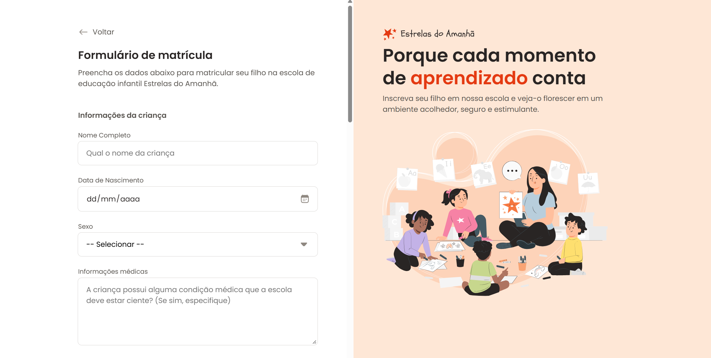

🌐 [English](README-en.md) | **Português**

# ⭐ Estrelas do Amanhã | Formulário de Matrícula


## 📖 Sobre o Projeto

Este projeto apresenta um formulário de matrícula para a escola de educação infantil fictícia Estrelas do Amanhã. A página orienta o preenchimento dos dados da criança e de seu responsável.

O formulário reúne informações pessoais, endereço, contato, turno de estudo e opção de esporte. Também inclui um campo para anexar a certidão de nascimento e uma confirmação de leitura dos termos.

A página foi construída com HTML e CSS, com layout responsivo para diferentes tamanhos de tela. Não há código de servidor ou JavaScript neste projeto, então o envio e o salvamento dos dados não estão integrados a um serviço.

## 📑 Sumário

- [Captura de tela](#-captura-de-tela)
- [🎯 Funcionalidades](#-funcionalidades)
- [🛠️ Tecnologias Utilizadas](#️-tecnologias-utilizadas)
- [🎨 Destaques de Design](#-destaques-de-design)
- [📂 Estrutura do Projeto](#-estrutura-do-projeto)
- [🌐 Visualizar o Projeto](#-visualizar-o-projeto)
- [📋 Pré-requisitos e 📝 Como Usar](#-pré-requisitos-e--como-usar)
- [📚 Conteúdo do Formulário](#-conteúdo-do-formulário)
- [💪 Desafios](#-desafios)
- [💡 Recursos de Aprendizado](#-recursos-de-aprendizado)
- [🚀 Sugestões de Melhorias](#-sugestões-de-melhorias)
- [👩‍💻 Autoria e Créditos](#-autoria-e-créditos)
- [📄 Licença](#-licença)

## 📸 Captura de tela



## 🎯 Funcionalidades

- **Cadastro da criança:** campos para nome, data de nascimento, sexo e informações médicas.
- **Anexo de documento:** campo de seleção de arquivo para a certidão de nascimento.
- **Endereço residencial:** campos para CEP e número, além de rua, cidade e estado exibidos desativados.
- **Contato do responsável:** campos para nome, telefone e e-mail. O e-mail é obrigatório e conta com validação nativa do navegador.
- **Opções de matrícula:** seleção de turno, entre manhã e tarde, e de uma opção de esporte.
- **Termos e condições:** caixa de seleção para indicar concordância.
- **Layout responsivo:** organização em coluna em telas menores e em duas áreas em telas maiores.
- **Ações do formulário:** botões para salvar respostas e fazer matrícula. O botão de salvar não tem uma ação implementada no código; não há integração de envio com um servidor.

## 🛠️ Tecnologias Utilizadas

- **HTML5:** estrutura da página, campos do formulário, agrupamento de informações e controles nativos.
- **CSS3:** estilos, layout responsivo, estados dos campos e personalização dos controles.
- **Poppins:** fonte carregada pelo Google Fonts para os textos da interface.
- **SVG:** ícones e ilustrações usados na página.

## 🎨 Destaques de Design

- Fundo branco na área do formulário e tom pêssego claro no painel de apresentação.
- Laranja usado em destaques, estados de interação e botão principal.
- Fonte Poppins e ícones personalizados para os campos.
- Em telas maiores, o conteúdo se divide entre o formulário e um painel com a identidade visual da escola. Em telas menores, as áreas ficam empilhadas.
- Campos, opções de seleção e área de arquivo têm estados visuais de foco e interação.

## 📂 Estrutura do Projeto

```text
formulario-de-matricula/
├── assets/
│   ├── icons/                 # Ícones dos campos e opções
│   └── images/                # Logo, ilustração e captura de tela
├── styles/
│   ├── fields/
│   │   ├── buttons.css        # Botões do formulário
│   │   ├── checkbox.css       # Caixa de seleção
│   │   ├── droparea.css       # Área de seleção de arquivo
│   │   ├── index.css          # Importação dos estilos dos campos
│   │   ├── input.css          # Campos de entrada
│   │   └── radio.css          # Opções de seleção
│   ├── forms.css              # Agrupamento e espaçamento do formulário
│   ├── global.css             # Estilos globais e variáveis
│   ├── index.css              # Importação dos estilos
│   └── layout.css             # Layout responsivo da página
└── index.html                 # Página do formulário
```

## 🌐 Visualizar o Projeto

[Abra o formulário de matrícula online](https://erikaestudar.github.io/course-project/formulario-de-matricula/index.html).

## 📋 Pré-requisitos e 📝 Como Usar

É necessário apenas um navegador atualizado. Para carregar a fonte Poppins do Google Fonts, é preciso estar conectado à internet.

1. Clone ou baixe este repositório.
2. Abra a pasta `formulario-de-matricula`.
3. Abra o arquivo `index.html` em um navegador.

## 📚 Conteúdo do Formulário

### 1. Informações da criança
Nome completo, data de nascimento, sexo, informações médicas e campo para selecionar a certidão de nascimento.

### 2. Endereço residencial
Campos de CEP e número, com rua, cidade e estado apresentados como campos desativados.

### 3. Informações do responsável
Nome do responsável, telefone e e-mail para contato.

### 4. Opções de matrícula
Escolha de turno, entre manhã e tarde, e seleção de uma opção de esporte: futebol, basquete, natação, yoga, voleibol ou boxe. A seção também inclui a caixa de concordância com os termos e a política de privacidade.

## 💪 Desafios

O principal desafio foi organizar a responsividade do formulário, adaptando sua disposição para telas menores e maiores sem prejudicar a leitura e o preenchimento dos campos.

## 💡 Recursos de Aprendizado

- Organização de formulários HTML com `fieldset`, `legend` e rótulos associados aos campos.
- Uso de campos de texto, data, seleção, área de texto, arquivo, rádio e caixa de seleção.
- Aplicação de estados visuais com seletores CSS como `:focus`, `:checked` e `:has()`.
- Criação de layouts responsivos com Flexbox, Grid e media queries.
- Separação dos estilos em arquivos por função.

## 🚀 Sugestões de Melhorias

- [ ] Implementar uma integração com servidor para receber os dados e o arquivo enviado.
- [ ] Criar uma ação para o botão “Salvar respostas”.
- [ ] Automatizar o preenchimento de rua, cidade e estado a partir do CEP.
- [ ] Completar os atributos de valor das opções de esporte para incluir essa escolha nos dados enviados.

## 👩‍💻 Autoria e Créditos

Projeto desenvolvido por [Erika Sugawara](https://github.com/Erikaestudar), como exercício da [Rocketseat](https://app.rocketseat.com.br/jornada/full-stack/sala/formularios-no-html/grupo/projeto-formulario-de-matricula/aula/apresentacao-do-projeto-7).

- **GitHub:** [@Erikaestudar](https://github.com/Erikaestudar)
- **LinkedIn:** [Erika Sugawara](https://www.linkedin.com/in/erika-sugawara/)

## 📄 Licença

Este projeto está sob a licença MIT. Consulte o arquivo [LICENSE](../LICENSE) para ver o texto completo.

**Desenvolvido com ❤️ como projeto educacional**
