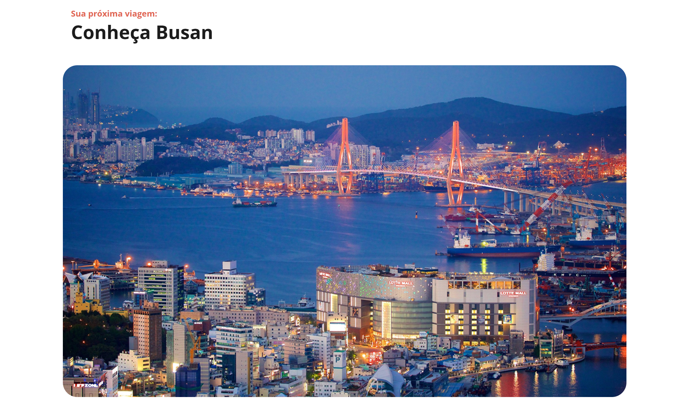

🌐 **[English](README-en.md)** | **Português**

# Local Turístico - Conheça Busan

## 📍 Sobre o Projeto

Um site informativo e interativo que apresenta as principais atrações turísticas de Busan, a segunda maior cidade da Coreia do Sul. O projeto destaca três destinos imperdíveis para amantes de história, com foco em templos budistas centenários e parques históricos.

O site é responsivo e oferece uma experiência intuitiva para os usuários, permitindo explorar informações detalhadas sobre cada atração de forma interativa.

### Sumário

- [Captura de tela](#captura-de-tela)
- [Funcionalidades](#funcionalidades)
- [Tecnologias utilizadas](#tecnologias-utilizadas)
- [Estrutura do projeto](#estrutura-do-projeto)
- [Visualizar o projeto](#visualizar-o-projeto)
- [Como usar](#como-usar)
- [Destinos apresentados](#destinos-apresentados)
- [Recursos de aprendizado](#recursos-de-aprendizado)
- [Licença](#licença)

### Captura de tela




## 🎯 Funcionalidades

- **Apresentação de Busan**: Título, imagem e texto introdutório sobre a cidade
- **Cards Interativos**: Sistema de acordeão para expandir e recolher informações sobre três destinos turísticos
- **Design Responsivo**: Adaptado para diferentes tamanhos de tela
- **Dropdown Dinâmico**: Clique nos cards para expandir e visualizar informações detalhadas
- **Navegação Intuitiva**: Interface limpa e fácil de usar

## 🛠️ Tecnologias Utilizadas

- **HTML5**: Estrutura semântica da página
- **CSS3**: Estilização modularizada e responsiva
  - Global: Estilos gerais e variáveis
  - Layout: Estrutura e grid do projeto
  - Article: Estilos específicos dos artigos e cards
- **JavaScript (Vanilla)**: Interatividade dos dropdowns
- **Google Fonts**: Tipografia (Open Sans)

## 📂 Estrutura do Projeto

```
local-turistico/
├── index.html           # Arquivo principal HTML
├── script.js            # Lógica JavaScript para interatividade
├── styles/
│   ├── index.css        # Arquivo CSS principal
│   ├── global.css       # Estilos globais
│   ├── layout.css       # Layout da página
│   └── article.css      # Estilos dos artigos e cards
└── assets/
    └── images/          # Imagens dos locais turísticos
```

## 🌐 Visualizar o Projeto

Acesse o projeto em funcionamento:
👉 [https://erikaestudar.github.io/course-project/local-turistico/index.html](https://erikaestudar.github.io/course-project/local-turistico/index.html)

## 📝 Como Usar

1. Abra o arquivo `index.html` em um navegador web
2. Explore a página principal com informações sobre Busan
3. Clique nos títulos dos cards para expandir e ver detalhes de cada atração
4. Clique novamente para recolher as informações

## 🎨 Destinos Apresentados

### 1. Templo Haedong Yonggungsa

Um dos poucos templos da Coreia construído à beira-mar, oferecendo vistas do Mar do Leste e montanhas circundantes.

### 2. Templo Beomeo-sa

Um dos maiores santuários da Coreia do Sul, localizado no alto da montanha Geumjeongsa, preservando arquitetura da Dinastia Joseon.

### 3. Parque Yongdusan

Central, abrigando a Torre Busan de 120 metros, museus e exposições de culturais.

## 💡 Recursos de Aprendizado

Este projeto foi desenvolvido como parte de um curso e demonstra:

- Estruturação semântica com HTML5
- Organização modular de CSS
- Implementação de interatividade com JavaScript puro
- Design responsivo e acessibilidade
- Otimização de performance

## 📄 Licença

Este projeto está incluído no repositório de projetos do curso.

---

**Desenvolvido com ❤️ como projeto educacional**
