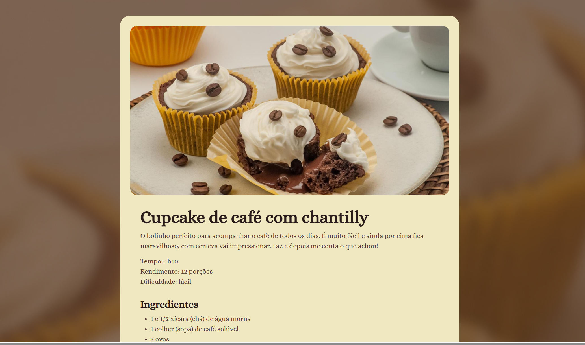

🌐 **Português** | [English](README-en.md)

# Página de Receita

## Sobre o Projeto

Este projeto é uma página de receita simples e estilizada, criada como parte de um desafio de front-end. A página apresenta uma receita de cupcake de café com chantilly, incluindo foto, ingredientes e modo de preparo.

## Sumário

- [Sobre o projeto](#sobre-o-projeto)
- [Captura de tela](#captura-de-tela)
- [Tecnologias usadas](#tecnologias-usadas)
- [O que está incluído](#o-que-está-incluído)
- [Detalhes do projeto](#detalhes-do-projeto)
- [Estrutura do projeto](#estrutura-do-projeto)
- [Como visualizar](#como-visualizar)
- [Sugestões de melhorias](#sugestões-de-melhorias)
- [Créditos](#créditos)

### Captura de tela



## Tecnologias usadas

- HTML5
- CSS3
- Fontes do Google Fonts (`Alice`)

## O que está incluído

- `index.html`: estrutura da página com conteúdo semântico.
- `styles/index.css`: estilos e layout responsivo da página.
- `assets/images/`: imagens usadas no projeto, como o cupcake e o ícone de coração.

## Detalhes do projeto

- Layout focado em leitura fácil e apresentação visual.
- Uso de section e article para organizar o conteúdo.
- Imagem destacada para ilustrar a receita.
- Texto com tempo de preparo, rendimento e nível de dificuldade.

## Estrutura do projeto

```
pagina-de-receita/
├── index.html              # Estrutura e conteúdo da página de receita
├── README.md               # Documentação em português
├── README-en.md            # Documentação em inglês
├── styles/
│   └── index.css           # Estilos e layout da página
└── assets/
    └── images/
        ├── background.jpg  # Imagem de fundo
        ├── cupcake.jpg     # Imagem do cupcake
        ├── heart-fill.svg  # Ícone de coração
        └── screenshot.png  # Captura de tela do projeto
```

## Como visualizar

1. Abra o site ao vivo: [Página de Receita](https://erikaestudar.github.io/course-project/pagina-de-receita/index.html).
2. Ou abra o arquivo `index.html` localmente no navegador.
3. Como alternativa, use um servidor local simples como o Live Server no VS Code.

## Sugestões de melhorias

- Adicionar interatividade com JavaScript, como um botão de alternativa de receita.
- Deixar o layout totalmente responsivo para mobile e tablet.
- Incluir mais receitas e navegação entre elas.
- Acrescentar animações sutis nos elementos usando CSS.

## Créditos

Desenvolvido por Erika Sugawara.
Projeto original baseado em um desafio da Rocketseat.
