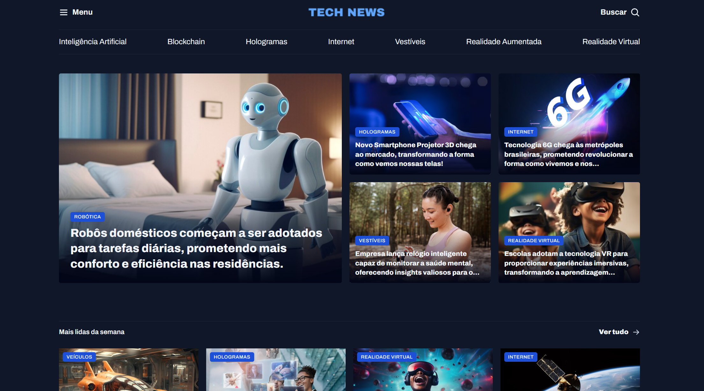

🌐 **Português** | [English](README-en.md)

# 📰 TechNews

## Sobre o Projeto

TechNews é um portal estático de notícias sobre tecnologia. A página organiza chamadas e textos curtos sobre robótica, inteligência artificial, internet, realidade virtual, dispositivos vestíveis e outros temas.

O conteúdo é apresentado em áreas de destaques, notícias mais lidas, matérias sobre inteligência artificial e recomendações. O layout se adapta a diferentes larguras de tela e inclui uma navegação horizontal por categorias.

## Sumário

* [Sobre o Projeto](#sobre-o-projeto)
* [Sumário](#sumário)
* [Captura de Tela](#captura-de-tela)
* [🎯 Funcionalidades](#-funcionalidades)
* [🛠️ Tecnologias Utilizadas](#-tecnologias-utilizadas)
* [📂 Estrutura do Projeto](#-estrutura-do-projeto)
* [🌐 Visualizar o Projeto](#-visualizar-o-projeto)
* [📝 Como Usar](#-como-usar)
* [🎨 Notícias e Temas Apresentados](#-notícias-e-temas-apresentados)
* [💡 Recursos de Aprendizado](#-recursos-de-aprendizado)
* [🚀 Sugestões de Melhorias](#-sugestões-de-melhorias)
* [Créditos](#créditos)
* [Licença](#licença)

## Captura de Tela



## 🎯 Funcionalidades

* **Destaques editoriais:** apresenta chamadas principais com imagens e categorias.
* **Seções de notícias:** organiza matérias em destaques da semana, inteligência artificial e recomendações.
* **Navegação por categorias:** usa links internos para algumas áreas da página.
* **Rolagem horizontal por arraste:** permite arrastar a barra de categorias com o mouse. Em telas touch, usa a rolagem nativa do navegador.
* **Layout responsivo:** reorganiza o conteúdo de acordo com a largura da tela.

## 🛠️ Tecnologias Utilizadas

* **HTML5:** estrutura o conteúdo e as seções da página.
* **CSS3:** define o visual, o layout em grid e as regras responsivas.
* **JavaScript:** adiciona o comportamento de arraste à navegação horizontal.
* **Google Fonts:** carrega as fontes Archivo e Archivo Black.
* **SVG e PNG:** usados nos ícones, no logotipo, nas imagens das notícias e no espaço de anúncio.

## 📂 Estrutura do Projeto

```text
portal-de-noticias/
├── README.md                 # Documentação em português
├── README-en.md              # Documentação em inglês
├── index.html                # Página principal
├── script.js                 # Rolagem horizontal por arraste
├── assets/
│   ├── Ads.png               # Imagem do espaço de anúncio
│   ├── Logo.png              # Logotipo
│   ├── icons/                # Ícones SVG da interface
│   │   ├── ArrowRight-hover.svg
│   │   ├── ArrowRight.svg
│   │   ├── List.svg
│   │   └── MagnifyingGlass.svg
│   └── images/               # Captura de tela e imagens das notícias
│       ├── screenshot.png
│       ├── Image 01.png
│       ├── Image 02.png
│       ├── Image 03.png
│       ├── Image 04.png
│       ├── Image 05.png
│       ├── Image 06.png
│       ├── Image 07.png
│       ├── Image 08.png
│       ├── Image 09.png
│       ├── Image 10.png
│       ├── Image 11.png
│       ├── Image 12.png
│       ├── Image 13.png
│       ├── Image 14.png
│       ├── Image 15.png
│       ├── Image 16.png
│       ├── Image 17.png
│       └── Image 18.png
└── styles/                   # Folhas de estilo
    ├── global.css
    ├── header.css
    ├── index.css
    ├── sections.css
    └── utility.css
```

## 🌐 Visualizar o Projeto

[Acessar o TechNews no GitHub Pages](https://erikaestudar.github.io/course-project/portal-de-noticias/index.html)

## 📝 Como Usar

1. Baixe ou clone o repositório.
2. Abra a pasta `portal-de-noticias`.
3. Abra o arquivo `index.html` em um navegador.
4. Para carregar as fontes do Google Fonts, mantenha uma conexão com a internet.

## 🎨 Notícias e Temas Apresentados

### 1. Robôs domésticos
A chamada apresenta robôs usados em tarefas diárias dentro de casa, com foco em conforto e eficiência.

### 2. Smartphone com projetor 3D
O destaque descreve um smartphone que projeta imagens em 3D.

### 3. Tecnologia 6G
A notícia apresenta a chegada da tecnologia 6G a metrópoles brasileiras.

### 4. Relógio inteligente e saúde mental
A chamada aborda um relógio vestível que monitora aspectos da saúde mental.

### 5. Realidade virtual nas escolas
O conteúdo trata do uso de realidade virtual para criar atividades imersivas de aprendizagem.

### 6. Veículo voador
A seção de notícias mais lidas apresenta um protótipo de veículo voador para transporte pessoal.

### 7. Hologramas em videoconferências
A chamada descreve uma função de hologramas em uma plataforma de videoconferência.

### 8. Consoles de videogame
O destaque aborda uma nova geração de consoles com gráficos realistas.

### 9. Internet via satélite
A notícia apresenta um projeto para levar internet de alta velocidade a áreas remotas por satélite.

### 10. Algoritmo preditivo
A matéria sobre inteligência artificial descreve um algoritmo que prevê eventos futuros.

### 11. Dispositivo portátil de tradução
A chamada apresenta um dispositivo que promete traduzir idiomas durante conversas.

### 12. Robôs de companhia para idosos
O texto aborda robôs projetados para oferecer companhia e apoio a pessoas idosas.

### 13. Aplicativo de foco e produtividade
A matéria descreve um aplicativo que usa inteligência artificial para apoiar a concentração e a organização do trabalho.

### 14. Monitoramento ambiental
A recomendação apresenta um aplicativo de monitoramento ambiental relacionado a práticas ecológicas.

### 15. Óculos de realidade virtual com feedback tátil
A chamada aborda óculos de realidade virtual que incluem retorno tátil.

### 16. Criptomoeda com foco sustentável
O destaque descreve uma moeda digital que busca reduzir o impacto ambiental associado à mineração.

### 17. Entregas com drones
A recomendação apresenta o uso de drones para realizar entregas de compras online.

### 18. Impressão 3D de órgãos
A chamada trata de uma tecnologia de impressão 3D aplicada à produção de órgãos humanos.

## 💡 Recursos de Aprendizado

* Organização de conteúdo editorial com elementos semânticos do HTML.
* Construção de layouts com CSS Grid e Flexbox.
* Adaptação da página para telas de diferentes tamanhos usando media queries.
* Uso de imagens, ícones SVG, tipografia externa e variáveis CSS.
* Manipulação de eventos de mouse para permitir a rolagem horizontal por arraste.

## 🚀 Sugestões de Melhorias

* Implementar a busca indicada no cabeçalho.
* Fazer o ícone de menu abrir uma navegação funcional.
* Substituir os links provisórios por destinos reais ou ações definidas.
* Carregar as notícias a partir de uma fonte de dados para facilitar a atualização do conteúdo.
* Incluir uma página ou uma visualização própria para cada notícia.

## Créditos

Projeto desenvolvido por Erika Sugawara como parte de projetos de curso da Rocketseat. A fonte, a autoria e a licença MIT estão registradas no repositório principal.

## Licença

Este projeto está sob a licença MIT. Consulte o arquivo [LICENSE](../LICENSE) na raiz do repositório.

**Desenvolvido com ❤️ como projeto educacional**
