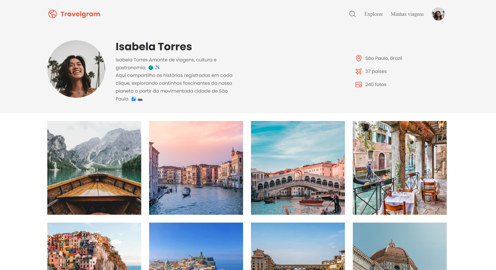

🌐 **Português** | [English](README-en.md)

# ✈️ Travelgram

<a id="sobre-o-projeto"></a>
## Sobre o Projeto

Travelgram é uma página de perfil e galeria de viagens. O perfil de Isabela Torres apresenta sua relação com viagens, cultura e gastronomia, além de informações sobre sua localização, países visitados e fotos.

A galeria exibe 12 imagens de paisagens, cidades e comida. O projeto foi feito como atividade de um curso da Rocketseat e pode ser aberto diretamente no navegador, sem etapa de compilação.

<a id="sumario"></a>
## Sumário

- [Sobre o Projeto](#sobre-o-projeto)
- [Sumário](#sumario)
- [Captura de Tela](#captura-de-tela)
- [🎯 Funcionalidades](#funcionalidades)
- [🛠️ Tecnologias Utilizadas](#tecnologias-utilizadas)
- [📂 Estrutura do Projeto](#estrutura-do-projeto)
- [🌐 Visualizar o Projeto](#visualizar-o-projeto)
- [📝 Como Usar](#como-usar)
- [🎨 Destinos e Fotos Apresentados](#destinos-e-fotos-apresentados)
- [💡 Recursos de Aprendizado](#recursos-de-aprendizado)
- [🚀 Sugestões de Melhorias](#sugestoes-de-melhorias)
- [Créditos](#creditos)
- [Licença](#licenca)

<a id="captura-de-tela"></a>
## Captura de Tela



<a id="funcionalidades"></a>
## 🎯 Funcionalidades

- **Perfil de viagem:** apresenta Isabela Torres, sua descrição e informações de perfil.
- **Galeria de fotos:** organiza 12 imagens em uma grade que se adapta à largura da tela.
- **Menu responsivo:** mostra um botão de menu em telas menores e fecha o menu ao selecionar um link ou clicar fora dele.
- **Campo de busca expansível:** abre e fecha o campo de texto. A busca não filtra as fotos nesta versão.
- **Fechamento pelo teclado:** a tecla `Escape` fecha o menu ou a busca e devolve o foco ao respectivo botão.
- **Navegação por âncoras:** os links do menu levam ao perfil ou à galeria.

<a id="tecnologias-utilizadas"></a>
## 🛠️ Tecnologias Utilizadas

- **HTML5:** estrutura o perfil, a navegação, a galeria e o rodapé.
- **CSS3:** define o visual, os layouts responsivos, os pontos de quebra e as variáveis de estilo.
- **JavaScript:** controla a abertura e o fechamento do menu e do campo de busca.
- **Google Fonts, Poppins:** fonte carregada do serviço Google Fonts.

<a id="estrutura-do-projeto"></a>
## 📂 Estrutura do Projeto

```text
travelgram/
├── assets/
│   ├── icons/                         # Ícones da navegação e do perfil
│   │   ├── AirplaneTilt.svg
│   │   ├── Image.svg
│   │   ├── MagnifyingGlass.svg
│   │   └── MapPin.svg
│   ├── images/                        # Galeria e captura de tela
│   │   ├── Image 01.png
│   │   ├── Image 02.png
│   │   ├── Image 03.png
│   │   ├── Image 04.png
│   │   ├── Image 05.png
│   │   ├── Image 06.png
│   │   ├── Image 07.png
│   │   ├── Image 08.png
│   │   ├── Image 09.png
│   │   ├── Image 10.png
│   │   ├── Image 11.png
│   │   ├── Image 12.png
│   │   └── sreenshot.png
│   ├── Logo.svg
│   └── Profile pic.png
├── styles/
│   ├── footer.css                     # Estilos do rodapé
│   ├── global.css                     # Variáveis e regras globais
│   ├── header.css                     # Perfil e informações
│   ├── index.css                      # Importação dos estilos
│   ├── main.css                       # Grade de fotos
│   └── nav.css                        # Navegação responsiva
├── index.html                         # Página principal
└── script.js                          # Interações de menu e busca
```

<a id="visualizar-o-projeto"></a>
## 🌐 Visualizar o Projeto

[Abra o Travelgram publicado no GitHub Pages](https://erikaestudar.github.io/course-project/travelgram/index.html).

<a id="como-usar"></a>
## 📝 Como Usar

1. Clone o repositório: `git clone https://github.com/Erikaestudar/course-project.git`
2. Entre na pasta do projeto: `cd course-project/travelgram`
3. Abra `index.html` em um navegador. Se preferir, use uma extensão de servidor local no editor.

Não é necessário instalar dependências nem executar uma etapa de build.

<a id="destinos-e-fotos-apresentados"></a>
## 🎨 Destinos e Fotos Apresentados

### 1. Lago alpino
Uma foto mostra um lago cercado por montanhas, visto de dentro de um barco de madeira.

### 2. Canal de Veneza ao entardecer
Edifícios acompanham um canal veneziano sob a luz do fim do dia.

### 3. Casas coloridas à beira-mar
A imagem mostra casas construídas sobre um penhasco junto ao mar.

### 4. Ponte de pedra em Veneza
Uma ponte de pedra cruza um canal cercado por edifícios venezianos.

### 5. Catedral de Florença
A foto destaca a cúpula e a fachada ornamentada da catedral.

### 6. Vila costeira
Casas coloridas aparecem junto a águas azul-turquesa.

### 7. Restaurante junto a um canal
Um terraço de restaurante fica ao lado de um canal veneziano.

### 8. Rua de casas coloridas
A cena mostra uma rua estreita com flores, casas coloridas e uma scooter.

### 9. Coliseu de Roma
O Coliseu aparece sob um céu azul.

### 10. Restaurante italiano
A fachada de um restaurante aparece com uma scooter branca à frente.

### 11. Pratos de massa
A foto mostra pratos de massa e taças sobre uma mesa de madeira.

### 12. Ponte Vecchio
A ponte aparece sobre o rio Arno, em Florença.

<a id="recursos-de-aprendizado"></a>
## 💡 Recursos de Aprendizado

- Organização de uma página com HTML semântico e descrições alternativas para as imagens.
- Criação de layouts responsivos com Flexbox e media queries.
- Uso de variáveis CSS e importação de folhas de estilo.
- Controle de elementos interativos com JavaScript, atributos ARIA e gerenciamento de foco.
- Tratamento de cliques fora dos controles, tecla `Escape` e redimensionamento da janela.

<a id="sugestoes-de-melhorias"></a>
## 🚀 Sugestões de Melhorias

- Fazer o campo de busca filtrar as fotos ou suas descrições.
- Exibir legenda e localização para cada imagem.
- Permitir ampliar uma foto em uma visualização individual.
- Manter a contagem do perfil sincronizada com o conteúdo da galeria.
- Transformar os textos de termos de uso e política de privacidade em links funcionais.

<a id="creditos"></a>
## Créditos

Projeto desenvolvido por Erika Miyuki Sugawara como parte de projetos de curso da Rocketseat. A fonte, a autoria e a licença MIT estão registradas no repositório principal.

<a id="licenca"></a>
## Licença

Este projeto está sob a licença MIT. Consulte o arquivo [LICENSE](../LICENSE) na raiz do repositório.

**Desenvolvido com ❤️ como projeto educacional**
